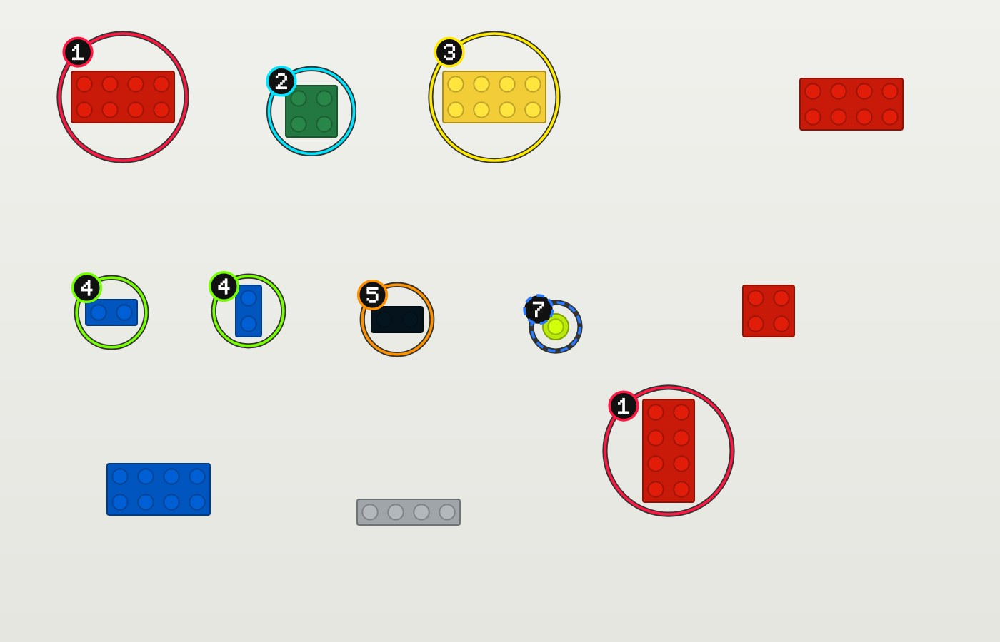

# LEGO Finder

Finds a LEGO model's pieces in photos of your collection. It circles each one and numbers it with its line in the model's parts list.



It is built as a **Unix-style pipeline** of small commands that pass JSON from one to the next:

```sh
legofinder parts https://rebrickable.com/mocs/MOC-37396/Schwimpy/31058-velociraptooth/ \
  | legofinder find --photos photos/ --out-dir out/ \
  | legofinder report > out/report.html
```

| Command | Reads | Writes (stdout) |
| --- | --- | --- |
| `parts <source>` | Rebrickable MOC/set URL, MOC id, set number, or Rebrickable CSV export (plus the optional offline catalogue) | `legofinder.parts/1` JSON: numbered parts list |
| `scan <photos…>` | photo files or folders | `legofinder.scan/1` JSON: pieces found in each photo |
| `find` | parts JSON (stdin or `--in`), plus `--photos` and/or `--scan` | `legofinder.find/1` JSON, plus annotated JPEGs in `--out-dir` |
| `report` | find JSON (stdin or `--in`) | one self-contained HTML page |

The design is in [docs/spec-mvp1.md](docs/spec-mvp1.md), and the long-term vision is in [docs/spec.md](docs/spec.md).

## Quick start

You need the [.NET 10 SDK](https://dotnet.microsoft.com/download).

```sh
dotnet build
dotnet test

# Run the offline demo (no network or API keys needed)
dotnet run --project src/LegoFinder.Cli -- find --in samples/demo/parts.json --scan samples/demo/scan.json --out-dir out/demo --recogniser none
```

To get a standalone executable, run `dotnet publish src/LegoFinder.Cli -c Release -o dist`, then use `dist/legofinder` (`legofinder.exe` on Windows).

## Using it with your own photos

1. **Take a photo** of the pieces spread out in one layer, **not touching**, on a plain background that contrasts with them. A sheet of white or grey card works best, since it also gives automatic white balance. Avoid trays, patterned fabric, piles and strong shadows. Check what was detected with `legofinder scan photos/ --recogniser none --annotate out/preview`.
2. **Get the parts list.** It's worth first downloading Rebrickable's free database export, which needs no account: "all_downloads.zip" from <https://rebrickable.com/downloads/>. Save it as `data/rebrickable/all_downloads.zip`, which is gitignored. `parts` then uses it automatically (or pass `--catalogue <zip>`, or set `LEGOFINDER_CATALOGUE`). It does two things:
   - **Official sets work offline**, with no API key: `legofinder parts 31058-1`.
   - **CSV and hand-written parts lists get filled in** with part names, pictures, and the BrickLink part and colour numbers. Brickognize reports BrickLink numbers, which sometimes differ from Rebrickable's (Rebrickable `6141` is BrickLink `4073`), so without this those parts can't match.

   The export has no MOCs, so for a MOC choose one of these:
   - From the Rebrickable API: works for **sets**, but *not* MOCs (see below). Get a free key from your Rebrickable profile → Settings → API. Copy `.env.example` to `.env` (gitignored) and fill in `REBRICKABLE_API_KEY`. The CLI reads `.env` from the current folder or any parent, and a real environment variable takes priority.
     **Rebrickable returns 403 for MOC parts lists**, even with a valid key (checked 2026-10-25), so for a MOC use the CSV export below.
   - From a CSV export, which needs no key. On the MOC's Rebrickable page, export the parts as "Rebrickable CSV", then run `legofinder parts velociraptooth.csv -o velociraptooth.json`. With the catalogue present, this gives the same detail as the API.
   - By hand. Any file matching `legofinder.parts/1` works (see [samples/demo/parts.json](samples/demo/parts.json)).
3. **Find the pieces and open the report:**
   ```sh
   legofinder find --in velociraptooth.json --photos photos/ --out-dir out/ -o out/find.json
   legofinder report --in out/find.json -o out/report.html
   ```

Each piece is cropped and sent to the free [Brickognize](https://brickognize.com) API to be identified, so `find` and `scan` need internet access. Results are cached by the crop's pixels (in `%LOCALAPPDATA%/legofinder/cache` or `~/.local/share/legofinder/cache`). Re-running on the same photo is therefore instant, and a new photo of moved pieces is recognised afresh.

**Colour is optional.** By default, any colour of the right part counts (a blue 2×4 can stand in for a red one), but the right colour is preferred when there's a choice. Pass `--match-colour` to require it. That also skips recognising pieces in colours the model doesn't use.

### Reading the output

- **Each number is the line number in the parts list.** If a line needs 3 pieces, up to three circles show that number.
- A **solid** ring is a confident match. A **dashed** ring means "maybe": the recogniser was unsure, or the line has no colour information.
- `find` exits with **0** if every line was found, **2** if some weren't (the output is still complete), and **1** on errors.

## Pipeline conventions

- stdout carries only data. Logs, progress and warnings go to stderr.
- Every stage can use files instead of pipes: use `--in` / `-o`.
- Every JSON document has a `schema` field, and each stage rejects documents of the wrong kind.
- **Windows:** Windows PowerShell 5.1 re-encodes text piped between programs. Use PowerShell 7, Git Bash or `cmd` for pipes, or use `--in`/`-o` files.

## Useful options

| Option | Commands | Default | Meaning |
| --- | --- | --- | --- |
| `--recogniser brickognize\|none` | scan, find | brickognize | `none` only segments (offline; handy for checking detection or hand-labelling) |
| `--threshold` | scan, find | 18 | Colour difference (ΔE) from the background that counts as "piece". Lower it for light pieces on a white background. |
| `--min-area` | scan, find | 0.0003 | Smallest piece, as a fraction of the photo area |
| `--annotate <dir>` | scan | | Also save each photo with every detection circled, to check what was found |
| `--scan <file>` | find | | Reuse a scan. Photos that have changed since are rescanned. |
| `--match-colour` | find | off | Require the parts list's colour. By default any colour of the right part counts, with the right colour preferred when there's a choice. |
| `--confident-score` | find | 0.55 | Recogniser score needed for a solid circle |
| `--max-colour-distance` | find | 25 | With `--match-colour`: ΔE allowed between the measured colour and the catalogue colour |
| `--prefilter-distance` / `--recognise-all` | find | 35 | With `--match-colour`: colour pre-filter applied before recognition |
| `--cache-dir` / `--no-cache` | scan, find | | Recognition cache location |

Run `legofinder <command> --help` for the full list.

## Project layout

```text
src/LegoFinder.Core/    all logic: contracts, parts sources, segmentation, recognition, matching, rendering, report
src/LegoFinder.Cli/     the `legofinder` executable (System.CommandLine); stdin/stdout/exit-code handling only
tests/                  xUnit v3 tests for both projects
samples/demo/           synthetic tray photo + hand-made scan + parts list; `dotnet run samples/demo/make-demo.cs` regenerates it
docs/                   specs
```

See [src/LegoFinder.Core/README.md](src/LegoFinder.Core/README.md) for how the library is put together and where to extend it.

## Tests and coverage

```sh
dotnet test
dotnet test --collect:"XPlat Code Coverage" --results-directory coverage
```

The tests run offline: HTTP is faked, and the images are synthetic or the demo photo. Line coverage is about 97% across `LegoFinder.Core` and the CLI.

## Known limitations (MVP)

- Pieces must lie in a single layer on a plain background. Touching pieces merge into one detection, and trays or patterned surfaces break detection. See the real-photo findings in [docs/spec-mvp1.md](docs/spec-mvp1.md#81-findings-from-the-first-real-photos-2026-10-25). A learned detector is the planned fix.
- Light pieces on a light background, or dark pieces on a dark one, need a contrasting background or a lower `--threshold`.
- Recognition quality depends on Brickognize and real photos. The demo's flat drawings are *not* recognised well online, which is why the demo uses a hand-made scan.
- Rebrickable gives a parts list, not a build-step order.

## Credits and licences

- Part recognition: [Brickognize](https://brickognize.com) ([terms](https://brickognize.com/terms-of-service/)).
- Parts and colour data: [Rebrickable](https://rebrickable.com). The colour table in `src/LegoFinder.Core/Parts/rebrickable-colors.csv` comes from Rebrickable's downloads, as does the optional `data/rebrickable/all_downloads.zip`.
- Imaging: [SkiaSharp](https://github.com/mono/SkiaSharp) (MIT). Command line: [System.CommandLine](https://github.com/dotnet/command-line-api) (MIT).
- LEGO® is a trademark of the LEGO Group, which does not sponsor, authorise or endorse this project.
